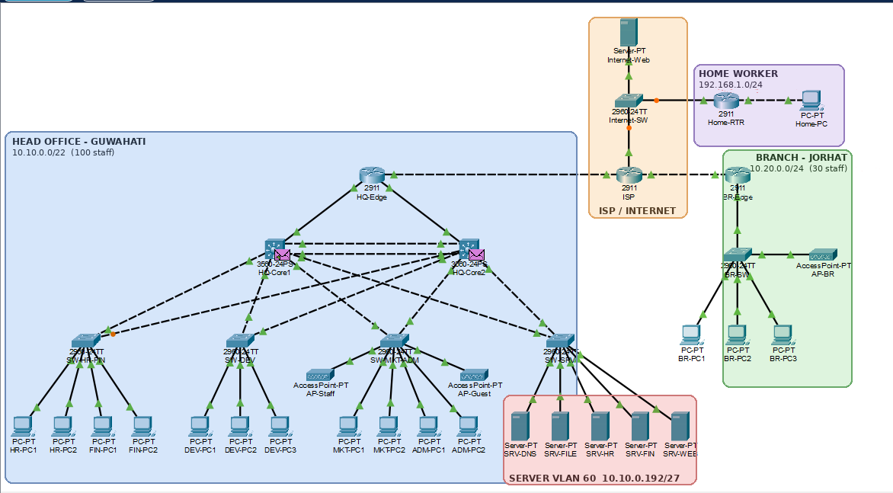
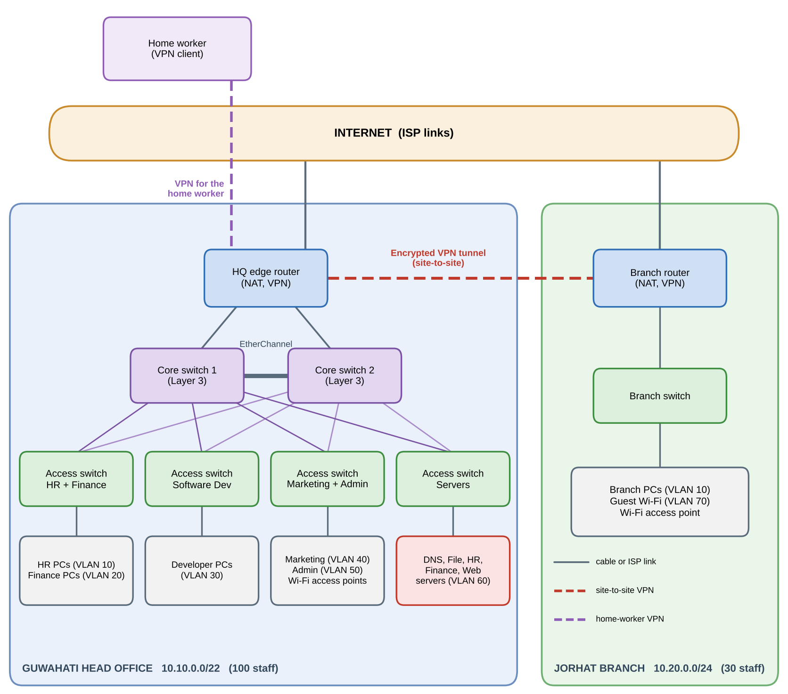
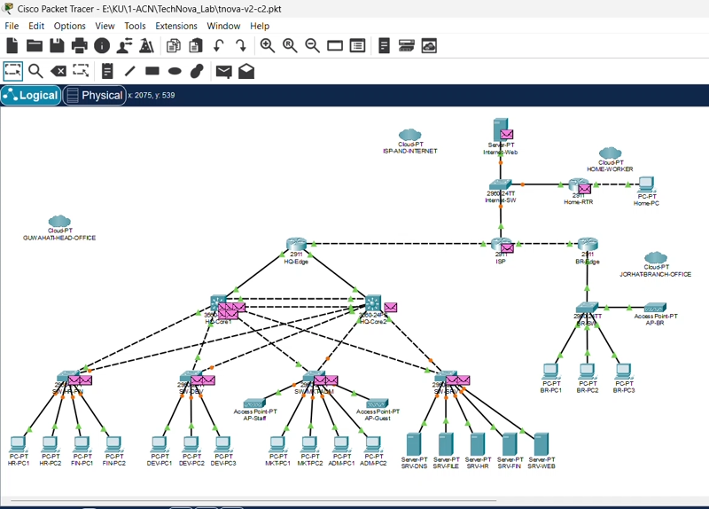
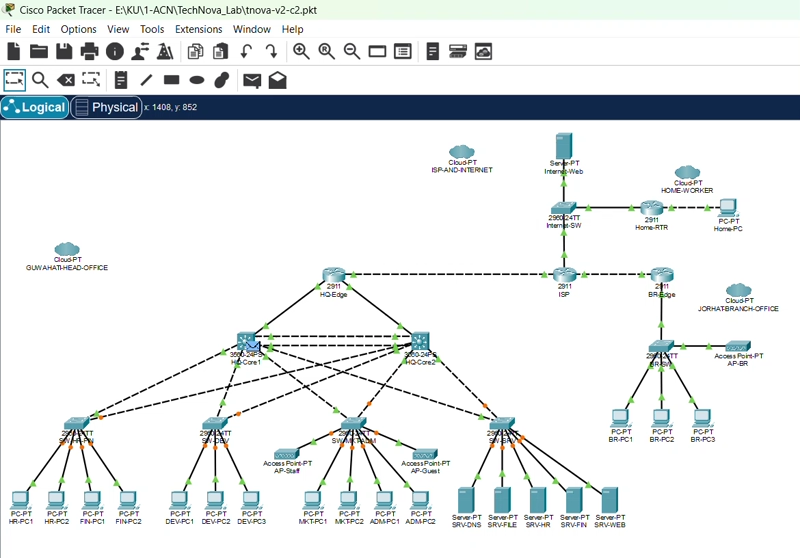
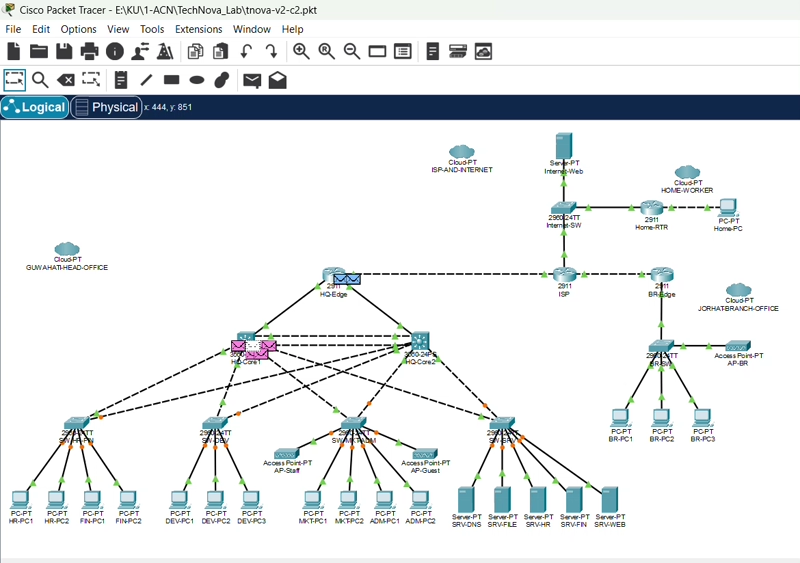

# Network Structure & Simulation Overview

**Company:** TechNova Solutions Pvt. Ltd.

**Lab Topology File:** [tnova-v2-c2.pkt](https://raw.githubusercontent.com/MadhurjyaBaruah/acn-mca-1/main/tnova-v2-c2.pkt) *(Click to download — Cisco Packet Tracer)*

## 1. Network Structure & Architecture

TechNova Solutions connects **130 employees** across two offices and remote home locations, using **VLANs** to keep each department's traffic isolated and secure.

### Guwahati Head Office (`10.10.0.0/22` , 100 Staff)

Built on a **hierarchical (extended) star topology** with two core switches so no single device failure can take down the office:

* **Edge Layer (`HQ-Edge`):** Connects the head office to the internet (`ISP`), translates private IPs to public IPs (NAT), and terminates VPN tunnels from the branch office and home workers.

* **Core Layer (`HQ-Core1` & `HQ-Core2`):** Two Layer 3 switches linked by a high-speed **EtherChannel** bundle. They act as the central routing brain between departments and share a virtual gateway (HSRP) for automatic backup.

* **Access Layer (4 Access Switches):** Each access switch connects upward to **both** `HQ-Core1` and `HQ-Core2` for redundancy, and divides staff and servers into isolated VLANs:

  * **`Acc-HR-Fin`:** HR PCs (`VLAN 10`) and Finance PCs (`VLAN 20`).

  * **`Acc-Dev`:** Software Development PCs (`VLAN 30`).

  * **`Acc-Mkt-Adm`:** Marketing PCs (`VLAN 40`), Administration PCs (`VLAN 50`), and office Wi-Fi Access Points (`AP-Staff`, `AP-Guest`).

  * **`Acc-Srv`:** Central company servers (`VLAN 60` — `SRV-DNS`, `SRV-FILE`, `SRV-HR`, `SRV-FIN`, and `SRV-WEB`).

### Jorhat Branch Office (`10.20.0.0/24` , 30 Staff)

Built on a **simple star topology** suited for a smaller team:

* **`BR-Edge` & `Acc-BR`:** One branch router connected to one branch switch serving Jorhat staff PCs (`VLAN 10`), Guest Wi-Fi (`VLAN 70`), and a wireless access point (`AP-BR`).

### Remote & Inter-Office Links

* **Site-to-Site VPN:** Connects `HQ-Edge` and `BR-Edge` securely across the `ISP` network.

* **Remote Worker VPN:** Connects `Home-PC` (via `Home-RTR` and `Internet-SW`) securely into `HQ-Edge` using encrypted VPN authentication.

## 2. Simple Explanation of the Network Diagram

* **No Single Point of Failure (Dual Uplinks):** Every access switch in Guwahati has two upward cables—one to `HQ-Core1` and one to `HQ-Core2`. If one core switch or cable fails, traffic automatically shifts to the second switch without disconnecting staff.

* **Department Privacy (VLANs & ACLs):** Even though all departments share the same building, VLANs and security rules (ACLs) prevent Marketing, Developers, or Branch users from opening private HR and Finance servers.

* **Guwahati-to-Jorhat Connection:** Instead of paying for an expensive private physical line between cities, `BR-Edge` and `HQ-Edge` build an encrypted **site-to-site VPN tunnel** over the internet so Jorhat staff can safely use head-office servers.

* **Working from Home:** A remote employee connects from `Home-PC` through a private, encrypted **VPN tunnel** straight to `HQ-Edge`, getting the same safe access as in the office.

* **Internet Access:** Both `HQ-Edge` and `BR-Edge` connect to the `ISP` cloud for web browsing, cloud apps, and video meetings.

## 3. Packet Tracer Simulation Demos

### Demo 1: Authorized Inter-VLAN & Jorhat Branch Access

* **What this demo shows:**

  1. **`DEV-PC1`** (Software Development) sends a request through `Acc-Dev` and `HQ-Core1` to the internal server VLAN (`SRV-DNS` / `SRV-FILE`) and receives a successful reply (green checkmark).

  2. Simultaneously, **`BR-PC1`** (Jorhat Branch) sends traffic through `BR-Edge`, `ISP`, and `HQ-Edge` over the encrypted site-to-site VPN tunnel to reach **`SRV-WEB`** at the Guwahati head office.

### Demo 2: Department Security (ACL) & Home-Worker VPN Access

* **What this demo shows:**

  1. **`DEV-PC1`** attempts to access the restricted HR/Finance servers and is **blocked** at `HQ-Core1` (red **X**), proving unauthorized departments cannot open confidential files.

  2. **`FIN-PC1`** (Finance) is **permitted** by the access list to reach **`SRV-FIN`** and receives a valid response.

  3. **`Home-PC`** connects securely through `Home-RTR`, `Internet-SW`, and the VPN tunnel into `HQ-Edge` to access authorized head-office servers.

### Demo 3: Core Switch Redundancy & Automatic Failover

* **What this demo shows:**

  1. All access links connected to **`HQ-Core1`** go down (indicated by the red link triangles), simulating a primary core switch failure.

  2. Traffic from **`DEV-PC1`** automatically reroutes through the backup uplink to **`HQ-Core2`** to reach the server VLAN and return without dropping the connection.
